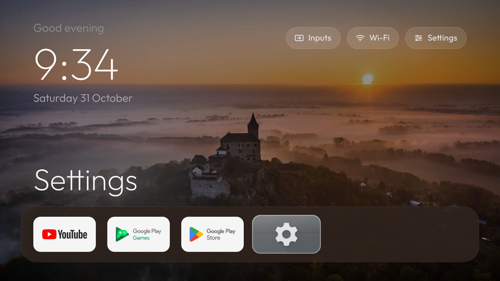
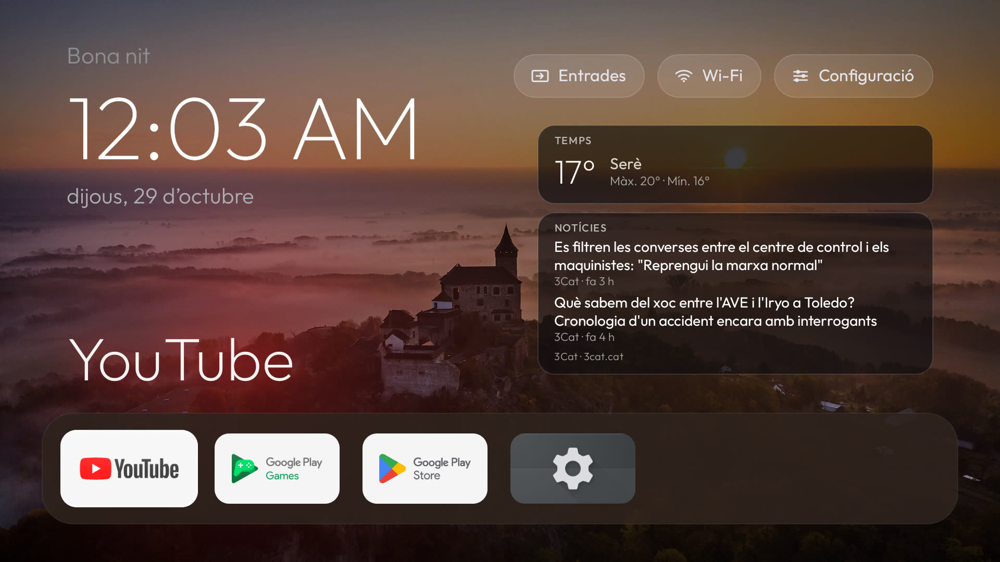
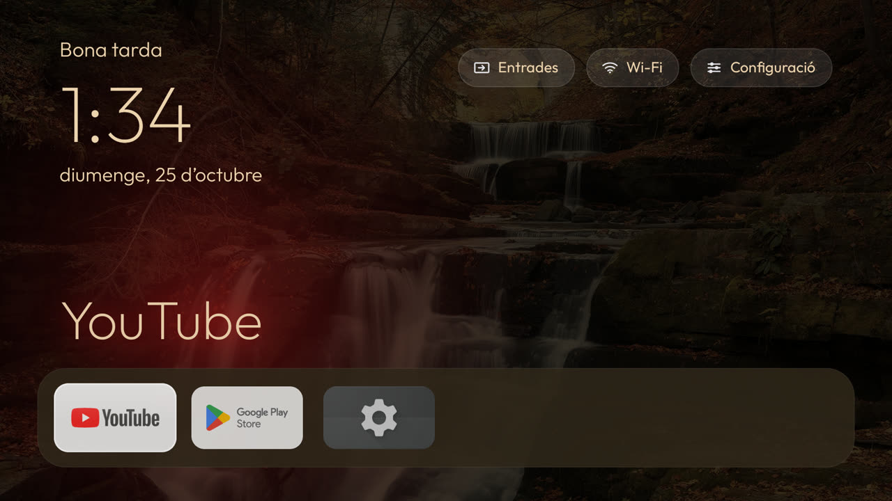
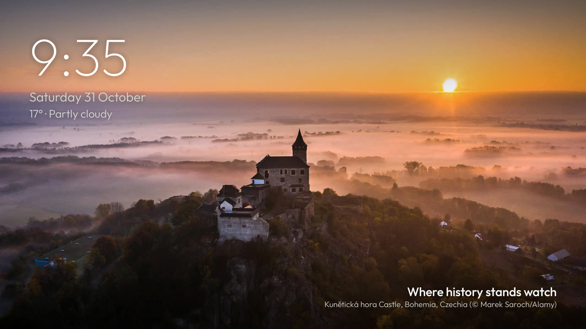
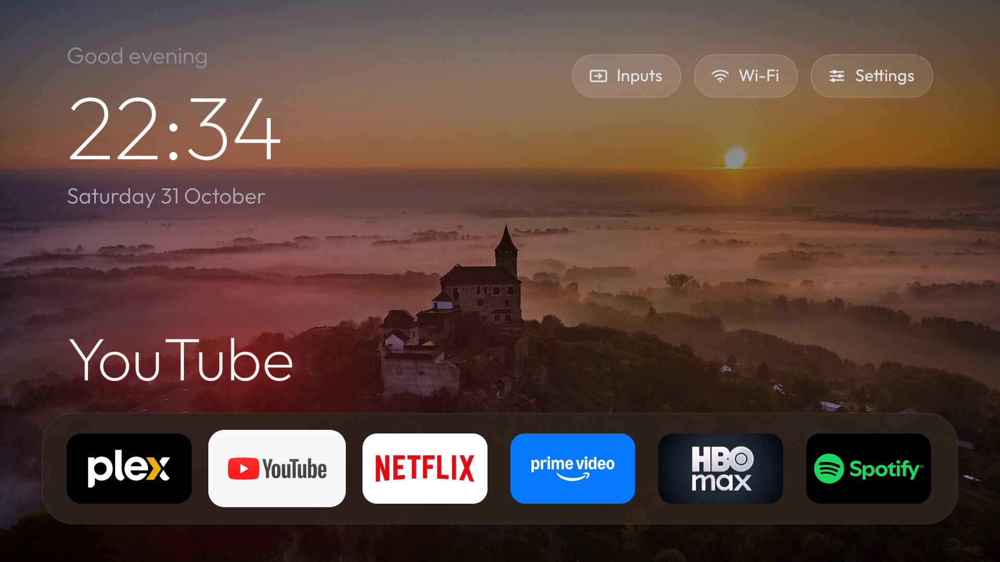
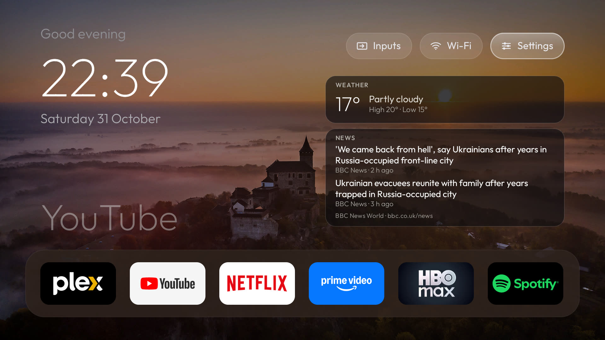
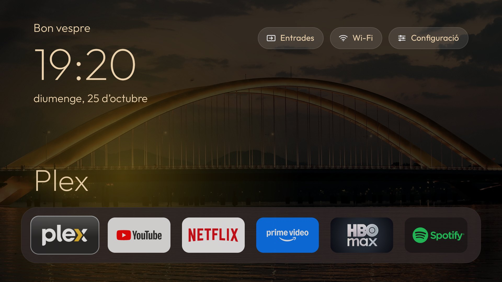
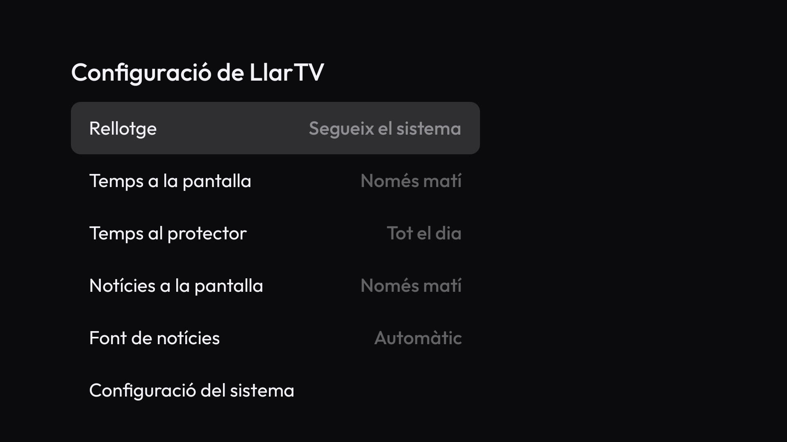
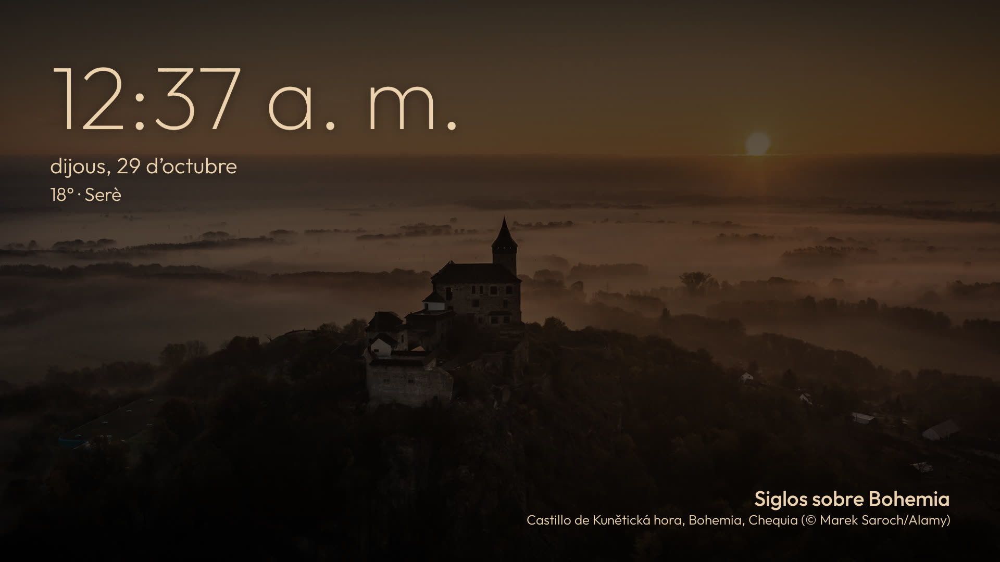

# LlarTV

A lightweight, native home screen for Android TV. (*Llar* is Catalan for "home".)

[](https://github.com/mmarkimark/llartv/releases/tag/v1.3)
[](https://github.com/mmarkimark/llartv/actions/workflows/ci.yml)
[](LICENSE)




LlarTV replaces the stock Android TV launcher with a clean, fast home screen built for the remote: a large clock, a
dock with your streaming apps, a full app grid, daily wallpapers and a matching screensaver. It is written in plain
Java, uses about 30–40 MB of RAM, and does no background polling: the clock and network name update from system
broadcasts, and network data is fetched only while the home screen is showing.

> **Project status:** LlarTV is a personal project. It is developed and tested on a Xiaomi MiTV-MSSP3
> (Android TV 11) and an Android TV 11 emulator. Other devices should work but are not regularly tested.

## Contents

- [Features](#features)
- [Screenshots](#screenshots)
- [Requirements](#requirements)
- [Installation](#installation)
- [Configuration](#configuration)
- [Screensaver](#screensaver)
- [Performance](#performance)
- [Building from source](#building-from-source)
- [Reporting issues](#reporting-issues)
- [How it was built](#how-it-was-built)
- [Origin and acknowledgements](#origin-and-acknowledgements)
- [License](#license)

## Features

**Home screen**

- Greeting, large clock and date, rendered with the Outfit typeface.
- Top bar with **Inputs** (HDMI/AV sources through the TV input framework, plus Live TV when available), **Wi-Fi**
  (current network name) and **Settings**. The Inputs button hides itself on devices with nothing to switch to.
- A dock of up to six favourite apps; the focused app's name is shown above the dock.
- A grid with every other launchable app. Helper apps without a TV entry point are left out automatically.
- Press and hold OK on a dock or grid app for its action menu: *Afegir al dock* or *Treure del dock*, *Moure a
  l'esquerra* / *Moure a la dreta*, *Moure amunt* / *Moure avall* (grid apps only, a whole row), *Amagar* or
  *Informació de l'app*; a move that would leave its row of apps is not shown. The edits write `dock`, `hidden`
  and `order` to `home.conf` at once, a full dock says so and writes nothing, and hidden apps come back from
  **Configuració → Apps amagades**.
- Your own grid order: moving a grid app keeps it in place across restarts and app updates. A newly installed
  app is added at the end without moving the others, and an uninstalled app leaves no gap. Moving a grid app
  never changes the dock (see `order` under [Configuration](#configuration)).
- Predictable D-pad navigation: Up/Down move exactly one row, the ends do not wrap, Back returns to the dock and
  Menu opens the app's info page. A short OK press launches the focused app; the last focused tile is remembered.

**Time of day**

- **Morning panel** (default 08:00–11:00): current weather from [Open-Meteo](https://open-meteo.com/) and the
  latest headlines from an RSS feed.
- The weather and the news are controlled separately, for the home screen and for the screensaver: never, only in
  the morning band or all day. What is switched off everywhere is not downloaded either.
- **Night mode** (default 23:00–08:00): a dimmer, warmer palette on the home screen and the screensaver, applied
  gradually when the band changes.
- **Photo-tinted dock**: the dock band takes a dark colour from the current wallpaper.

**Settings**

- A native settings menu on the TV (**Configuració** in the top bar), navigable with the remote. It opens as a side
  panel on the right, like the Android TV settings, with the home screen still visible behind it. It writes to the
  same `home.conf` as the ADB scripts, and the Android/TV settings stay reachable from it.
- Clock format: follow the TV, 24-hour or 12-hour with AM/PM, applied to the home screen, the screensaver and the
  next-match card.
- Wallpaper and night mode: Bing photos or a plain background, how often the photo changes (every 15 min, 30 min,
  hour or 3 hours, or *Fixa*: always the newest photo, which still changes when Bing publishes a new one), and night
  mode off or one of several ranges across midnight. An image URL, an interval or a range set by the scripts is kept
  and shown as one more choice.
- Screensaver clock and motion: hide the time (the date, the weather and the photo credits stay) and turn off the
  slow zoom, so each photo stays still and still changes every 25 seconds with a fade.
- Iniciar el protector: starts the LlarTV screensaver now, with its current options, through the TV's own
  "start now" entry (SystemUI's `Somnambulator`). It changes no setting: the inactivity timeout and the chosen
  screensaver stay as they are. When LlarTV is not the TV's screensaver, the screensaver is switched off, or the
  TV has no such entry, it shows why instead of starting anything else.
- Apps amagades: the hidden apps, with their count as the value. OK opens the list by label (the package name
  when the app is not installed any more) and unhides one app, writing `hidden`.
- Restablir la configuració: puts LlarTV's own settings back to their defaults after a confirmation that shows
  what is reset and what is kept, with Cancel focused first (see [Resetting the settings](#resetting-the-settings)).
- News source: 3Cat (Catalan), BBC News Mundo (Spanish) or BBC News World (English), with the source credited next
  to the headlines and the article link kept with them. A custom RSS feed always wins over the preset.

**Wallpapers and screensaver**

- Daily wallpapers from Bing (the last eight images, optionally rotating) or from any image URL.
- A built-in screensaver (*BingDream*) with a slow zoom and cross-fade over the wallpapers, the clock, the date
  and the current weather.
- Optional screensaver music, off by default: a cached playlist rotates approximately every two minutes
  through Holizna's CC0 "Dancing" and Kevin MacLeod's CC BY 4.0 "Chill Wave" and "Dream Culture".
  Original MP3s download outside the APK and are reused offline; the settings menu has offline music credits.
  A custom HTTPS stream retains its own programming, without forced rotation. Music stops with the screensaver;
  failures leave the visuals running silently. Historical real-TV evidence covers the v1.2 single-track loop,
  not the new v1.4 playlist, whose final device/release checks are still pending. See
  [docs/screensaver-music.md](docs/screensaver-music.md).

**Other**

- Optional "next match" card for a football club, using ESPN's public schedule. It hides itself if the feed fails.
- Interface in Catalan (the default), Spanish or English, chosen under **Configuració → Idioma** or with
  `language=`; it is independent of the TV's system language, time zone and clock format.

## Screenshots

| Morning (08:00–11:00) | Night (23:00–08:00) |
| --- | --- |
|  |  |



*Captured on the Android TV 11 emulator. Wallpapers are Bing images; credits appear on the screensaver.*

The same three bands on the TV itself (Xiaomi MiTV-MSSP3, Android 11):

| Day | Morning (08:00–11:00) | Night (23:00–08:00) |
| --- | --- | --- |
|  |  |  |

*The morning panel shows live weather and headlines with the source credited under them; the night palette dims the
wallpaper and warms the text.*

The settings menu and the screensaver on the TV:

| Settings | Screensaver |
| --- | --- |
|  |  |

## Requirements

- An Android TV or Google TV with Android 9 or newer.
- A computer (Linux, macOS, or Windows with [Git Bash](https://git-scm.com/downloads)) on the same network as
  the TV, with [ADB](https://developer.android.com/tools/adb) installed:

  | System | Command |
  | --- | --- |
  | Linux (Debian, Ubuntu) | `sudo apt install adb` |
  | macOS | `brew install --cask android-platform-tools` |
  | Windows | `winget install Google.PlatformTools` |

## Installation

**1. Let the computer talk to the TV.** On the TV:

1. Open *Settings → Device Preferences → About* and select **Build** seven times, until the TV says you are a
   developer.
2. Open *Settings → Device Preferences → Developer options* and turn on **USB debugging** (and **Network
   debugging** or **ADB debugging** if your TV lists it).
3. Open *Settings → Network & Internet*, select your network and note the TV's **IP address**, for example
   `192.168.1.50`.

**2. Get LlarTV** on the computer, with Git or as a ZIP (*Code → Download ZIP* on GitHub, then unzip it):

```sh
git clone https://github.com/mmarkimark/llartv.git
cd llartv
```

**3. Install it**, using your TV's IP address:

```sh
./scripts/install.sh 192.168.1.50
```

The first time, the TV asks *"Allow USB debugging?"*: tick *Always allow from this computer* and choose **OK**.

The script downloads the latest release, installs it, makes it the home screen and the screensaver, and turns off
the TV's own launcher if it would take the Home button back. Press **Home** on the remote: you should see LlarTV.

To keep the TV's own screensaver, add `--no-screensaver`. To install an APK you built or downloaded yourself, add
`--apk <file>`.

The released APK is signed with a debug key. If you later install a build signed with a different key, uninstall
LlarTV first: Android refuses to replace an app signed with another key.

**4. When you are done**, you can turn USB debugging off again on the TV. Turn it back on to change the settings
or to uninstall.

### Uninstalling

```sh
./scripts/uninstall.sh 192.168.1.50
```

This removes LlarTV and puts back the TV's own launcher and screensaver, exactly as they were.

## Configuration

LlarTV works without any configuration. To change something, run `scripts/config.sh` with one or more
`key=value` settings; LlarTV restarts with them straight away. The scripts remember the last TV you used, so the
IP address is only needed the first time (or with `--tv <IP>` for another TV).

The same settings are also available on the TV itself: open **Configuració** in the top bar and change them with
the remote. Both ways write to the same file, so it does not matter which one you use.

```sh
./scripts/config.sh --dock                         # choose the dock apps from a list
./scripts/config.sh night=22:30-07:30 columns=5    # change one or more settings
./scripts/config.sh location=41.98,2.82            # weather for another place (latitude,longitude)
./scripts/config.sh night=                         # an empty value restores the default
./scripts/config.sh --show                         # show what you have changed
```

| Key | Default | Description |
| --- | --- | --- |
| `columns` | `6` | Grid columns; the dock holds the same number of apps. 4–6 work best. |
| `dock` | built-in list | Comma-separated package names for the dock, in order. Set with `--dock` or by holding OK on an app from the TV; when set, the dock shows exactly these apps (installed ones, up to `columns`) and is **not** filled from the grid — the automatic fill only applies to the built-in list and `dock.txt`. |
| `hidden` | empty | Comma-separated package names to keep out of the grid and the dock (hide with the app's long-OK menu; recover them under **Configuració → Apps amagades**). Hiding never uninstalls or disables an app. |
| `order` | empty | The grid order: comma-separated package names, with no fixed positions. Empty sorts the grid by name. The first move of a grid app from the TV writes every installed app in its current order; listed apps come first, in that order, and any other app follows by name, so a new install is added at the end. The dock is placed first and is never changed by `order` (an automatically filled dock still takes the first apps by name); an app taken out of the dock returns to its place in the order. Hidden apps keep their place and get it back when unhidden. An uninstalled app leaves no gap and is dropped from the list on the next move, so if it is reinstalled after that it counts as new and goes at the end; reinstalled before then, it returns to its old place. |
| `wallpaper` | `bing` | `bing` for Bing's daily images, an image URL, or `off` for a plain background. |
| `wallpaper_minutes` | `30` | Rotate through the downloaded images every N minutes; `0` shows the newest (*Fixa* in the menu). |
| `morning` | `08:00-11:00` | Morning panel time range; `off` turns it off. |
| `night` | `23:00-08:00` | Night mode time range; `off` turns it off. |
| `location` | `41.4235,2.2010` (Barcelona) | `latitude,longitude` used for the weather. |
| `language` | `ca` | Interface language: `ca` (Catalan), `es` (Spanish) or `en` (English). A new installation and an upgraded one without this line are in Catalan; an unknown value keeps Catalan. It never changes the TV's system language, time zone or clock format. |
| `news_source` | `automatic` | News source: `automatic` (follows `language`: 3Cat, BBC News Mundo or BBC News World), `3cat`, `bbc-mundo` or `bbc-world`. |
| `news_rss` | empty | Custom RSS feed for the morning headlines; it wins over `news_source` and is never overwritten by it. Remove the line to use a preset again. |
| `music_screen` | `off` | Music during the screensaver: `on` or `off`. Off means no music download or player. |
| `music_url` | empty | Empty selects the verified cached playlist; a custom HTTPS audio URL overrides it without caching or forced rotation. See [docs/screensaver-music.md](docs/screensaver-music.md). |
| `clock_screen` | `on` | The time on the screensaver: `on` or `off`. Off hides the time only; the date, the weather and the photo credits stay. |
| `motion_screen` | `on` | The slow zoom and drift of the screensaver photos: `on` or `off`. Off keeps each photo still; the photos still change every 25 seconds with a fade. |
| `dock_tint` | `on` | Tint the dock band from the wallpaper; `off` uses a plain band. |
| `clock` | `system` | Clock format: `system` follows the TV, `24` is 24-hour, `12` is 12-hour with AM/PM. |
| `weather_home` | `morning` | Weather on the home screen: `never`, `morning` or `all`. |
| `weather_screen` | `all` | Weather on the screensaver: `never`, `morning` or `all`. |
| `news_home` | `morning` | News on the home screen: `never`, `morning` or `all`. |
| `team_id` | empty | ESPN team id for the next-match card (for example `83` for FC Barcelona). |
| `team_name` | empty | Name shown on the next-match card. |

Settings are stored on the TV in LlarTV's `home.conf` (one `key=value` per line). Remote wallpapers are refreshed
at most every six hours, and only new Bing images are downloaded.

The news source can also be changed from the TV itself: **Configuració → Font de notícies** offers the presets.
A custom `news_rss` feed has priority over them; remove it from `home.conf` to use a preset again.

### Resetting the settings

**Configuració → Restablir la configuració** puts every setting in the table above back to its default. It first
shows what is reset and what is kept, with *Cancel·lar* focused; Cancel or Back changes nothing. *Restablir*
removes the lines of those keys from `home.conf` (so the language is Catalan again, the dock comes from
`dock.txt` or the built-in list, no app is hidden and the grid is sorted by name), with the same atomic write as
every other setting. Comments, blank lines and unknown lines in `home.conf` are kept as they are, and nothing else
is touched: not `dock.txt`, the downloaded or pushed wallpaper images, the music, other caches, the installed
apps, nor Android settings such as the default launcher or screensaver. If the file cannot be read or written, a
message says so and `home.conf` stays exactly as it was. `scripts/config.sh` keeps working afterwards.

## Screensaver

The screensaver shows the downloaded wallpapers full screen, with a slow zoom and a cross-fade every 25 seconds,
together with the clock, the date, the weather and each image's title. It runs entirely from local files, and
any key on the remote closes it. It can also play optional music, off by default, downloaded once and reused
offline; see [docs/screensaver-music.md](docs/screensaver-music.md).

`install.sh` sets it up. You can also choose it, or switch back to another one, under *Settings → Device
Preferences → Screen saver*.

## Performance

LlarTV is kept small and fast: the released APK is about 4 MB, the app uses about 30–40 MB of RAM and it does no
background polling. [`scripts/measure.sh`](scripts/measure.sh) records the APK size, the cold start, the Home
return and the RAM on a connected TV or emulator. The measured baseline and the regression budgets used as release
gates are in [`docs/performance/baseline-v1.0.md`](docs/performance/baseline-v1.0.md).

## Building from source

You need JDK 17 and the Android SDK (platform 33, build-tools 36).

```sh
echo "sdk.dir=$ANDROID_HOME" > local.properties
./gradlew testDebugUnitTest assembleDebug
./scripts/install.sh 192.168.1.50 --apk app/build/outputs/apk/debug/app-debug.apk
```

Unit tests run on the JVM and cover configuration parsing, time bands, colour handling, weather and news parsing,
wallpaper selection, and the three interface languages (every text resolved from the resource files, with
key, placeholder and plural parity).

Project layout:

```text
app/src/main/java/io/github/mmarkimark/llartv/   Launcher, screensaver and data sources
app/src/test/java/io/github/mmarkimark/llartv/   JVM unit tests
scripts/                                         Install, configure and uninstall over ADB
docs/design/                                     Design notes
```

## Reporting issues

Bugs and feature requests are tracked in [GitHub Issues](https://github.com/mmarkimark/llartv/issues).

1. Search [existing issues](https://github.com/mmarkimark/llartv/issues?q=is%3Aissue), including closed ones,
   to avoid duplicates.
2. Choose **New issue** and pick the form that fits: **Bug report** or **Feature request**.
3. Fill in every required field. For bugs, include the LlarTV version, the device model, the Android version,
   clear steps to reproduce, and a `logcat` excerpt when the app crashes:

   ```sh
   adb logcat -d | grep -i llartv
   ```

See [CONTRIBUTING.md](CONTRIBUTING.md) for the full guidelines, including branch and commit conventions, and
[CHANGELOG.md](CHANGELOG.md) for what changed in each release.

## How it was built

LlarTV's own features were developed with [Claude Code](https://claude.com/claude-code) configured by
[Gentle AI](https://github.com/Gentleman-Programming/gentle-ai), which adds persistent memory, curated skills and
its *Organic Driven Development* (ODD) workflow. Each feature starts as a short design note and a task log, both
kept in the repository:

- [`docs/design/`](docs/design/) holds the design notes, written and approved before any code.
- [`odd/tasks/`](odd/tasks/) holds the task logs: the requirements quoted verbatim, the tasks with their commits,
  and the verification done on the emulator and on the TV.

Changes are covered by JVM unit tests and checked on the Android TV emulator and on the TV itself.

<a href="https://github.com/Gentleman-Programming/gentle-ai">
  
</a>

## Origin and acknowledgements

LlarTV started from the launcher of an Android TV debloating toolkit. Its lineage:

| Project | Author | Contribution |
| --- | --- | --- |
| [tv-vibehack](https://github.com/Gathin23/cleanyourtv) (now *cleanyourtv*) | [Gathin](https://github.com/Gathin23) | Original launcher design and concept (MIT) |
| [android-tv-debloat](https://github.com/amirulmzlan/android-tv-debloat) | [Amirul Mazlan](https://github.com/amirulmzlan) | TvHome, the native launcher LlarTV is built on (MIT) |
| [android-tv-debloat](https://github.com/wakjenal/android-tv-debloat) (fork) | [wakjenal](https://github.com/wakjenal) | Fork LlarTV was started from |
| LlarTV (this repository) | [mmarkimark](https://github.com/mmarkimark) | Bing wallpapers, screensaver, time-of-day modes, weather and news, Catalan interface |

Third-party resources:

- [Outfit](https://fonts.google.com/specimen/Outfit) typeface, licensed under the
  [SIL Open Font License 1.1](app/src/main/assets/fonts/OFL.txt).
- Weather data by [Open-Meteo](https://open-meteo.com/) (CC BY 4.0).
- Wallpapers and their titles are provided by Microsoft Bing and remain the property of their respective owners.

## License

LlarTV is released under the [MIT License](LICENSE). The copyright notices of the original authors are retained
as the license requires.
