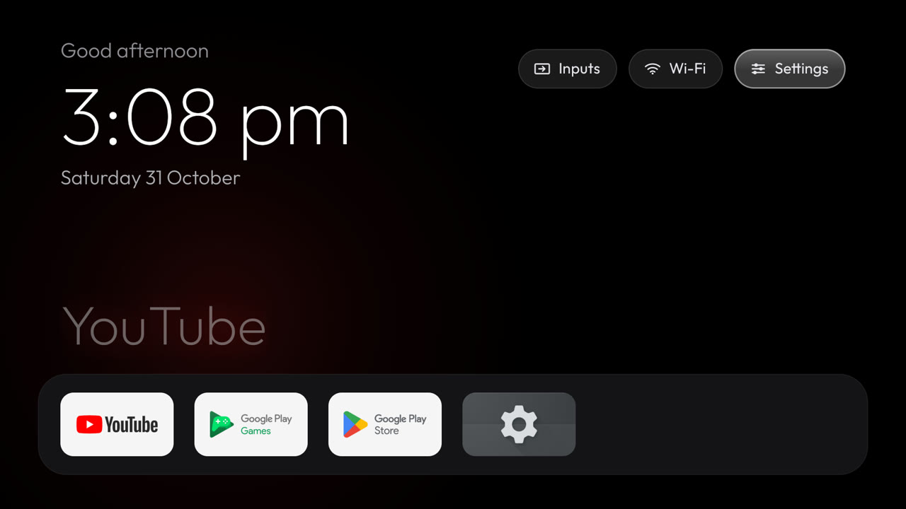
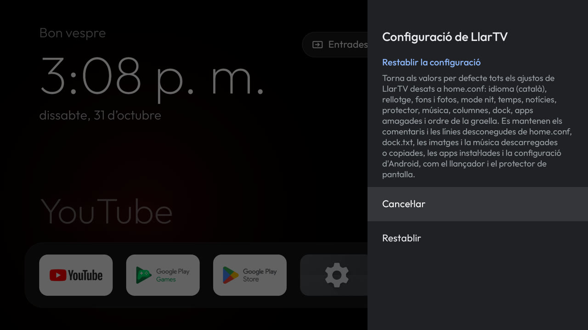
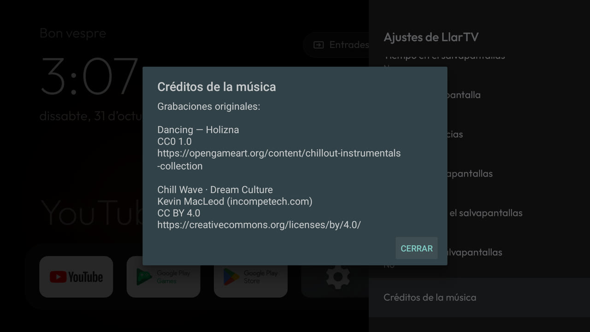

# v1.4 acceptance

Implementation, independent JVM verification, emulator checks, the controlled paired reference-TV guard and the
public release verification all passed. The owner confirmed audible distinct tracks. **v1.4 is released**
([tag `v1.4`](https://github.com/mmarkimark/llartv/releases/tag/v1.4), published 2026-10-31); this document
records the evidence for each check and the limits of what each proof shows.

## Review and integration path

Source work units: `9c9ffce`, `faf6ea1`, `40ec3eb`, `8b55af8`, `3646f4f`, `4c9e464`, plus the release unit
`2b945bf`. The release has `versionName=1.4`, `versionCode=5`. No new runtime dependency; audio remains outside
the APK and default-off.

Review [tracker PR #40](https://github.com/mmarkimark/llartv/pull/40) through its seven focused children
[#41](https://github.com/mmarkimark/llartv/pull/41)–[#47](https://github.com/mmarkimark/llartv/pull/47).
Each child merged only after the CI run for its exact head commit passed `Tests and build` and
`Shell scripts`. `main` advanced to `3997037`, whose tree is byte-identical to the independently verified
candidate `2b945bf`, and every original source commit remains an ancestor of the release. The final metadata
unit passed native review `review-b1212fa14dcf8a0b` (approved and acknowledged; seven informational advisories,
no correction) and a separate independent verifier.

A fresh isolated verification of `4c9e464` executed all 38 Gradle tasks: **277 JVM tests, zero failures/errors/skips**,
plus the APK build. Security-sensitive transport and audio callback/focus lifecycle received independent
verification; required earlier native reviews were approved and acknowledged. Applicable ordinary checks passed:

```sh
JAVA_HOME=$HOME/.local/jdk17 ./gradlew testDebugUnitTest assembleDebug
shellcheck -x -P SCRIPTDIR/.. scripts/*.sh
git diff --check
```

## Android TV emulator checks

Target: AVD `tv11`, AOSP TV x86, Android 11/API30, 1920×1080, headless/no-audio. Tests used isolated configuration
fixtures through the existing public ADB receiver, navigation through D-pad key events and public UI/system
observations. Original configuration bytes were backed up, restored and read back after each completed check;
Android dream/enabled/timeout/stay-awake settings and the default home were preserved. These emulator checks did
not modify the physical TV; the subsequent reference-TV run is recorded separately below.

| Scope | Observed result |
| --- | --- |
| Grid #13 | Long OK opens the grid action menu; moving changes only `order`. Restart preserves the move; boundaries remain navigable. Dock, hidden entries, comments and unknown settings are unchanged. |
| Start now #34 | The settings action starts a running `BingDream` and displays its clock/date, without changing Android dream settings. Music-off mode does not take audio focus. |
| Languages #11 | Remote selection of Spanish, English and Catalan persists and rebuilds settings immediately; Home follows on return/restart. Credits are available in each language; clock preference and custom RSS survive language changes. |
| Reset #9 | Initial OK on the confirmation cancels without a write. Explicit Confirm removes only known keys; unknown/comment/blank lines remain, and defaults persist after restart. |
| Music #35 | All three validated local files play offline, wrap to Dancing, retain focus across track changes and release it on exit. New files were manually precached for this offline run; the public download is verified separately below. |

### Timed local playback

Android had **no active default network** during the timed run. The actual player-start log and per-start
player/focus diagnostics recorded:

| Transition | Elapsed seconds |
| --- | --- |
| Dancing → Chill Wave | 120.067 |
| Chill Wave → Dream Culture | 120.200 |
| Dream Culture → Dancing | 120.041 |

The decoder/player and focus observations are not human listening evidence: the emulator has no audio output.
Transient focus loss, early completion, stale callbacks and failures were covered by JVM/independent verification,
not separately injected on Android in this session. Original Dancing remained unchanged; only newly seeded test
audio was removed, and Wi-Fi/configuration/Android settings were restored after the run.

### Screenshots

These are isolated emulator fixtures without account or private Wi-Fi data; existing app icons/titles are external
data. The settings panel changes language immediately; the dimmed Home underneath refreshes on return.







## Reference-TV playback and restoration

After the owner made the TV available, the Xiaomi MiTV-MSSP3 (Android11/API30) was backed up before writes:
original configuration, internal files, installed published1.3 APK and relevant Android/default-Home/network/ADB/
clock/locale/timezone state. Matching signatures allowed an in-place1.4/code5 upgrade without uninstall or wipe.
**Reset was never tested on the physical TV.** Backups, private UI captures and the owner's photos/config stay ignored.

The settings action was selected with ADB D-pad events and started a running `BingDream`. Actual player logs and
current audio-focus diagnostics recorded the local playlist, with validated manually seeded files outside the APK:

| Transition | Elapsed seconds |
| --- | --- |
| Dancing → Chill Wave | 120.157 |
| Chill Wave → Dream Culture | 120.178 |
| Dream Culture → Dancing | 120.123 |

Focus was present at every start. Normal Back/Home exit retained the **same app process**, with neither app audio
focus nor a media-player client left afterwards, before any force-stop. This isolates normal cleanup from process death.
Original configuration bytes and Android/default-Home/network/ADB/clock/locale/timezone state were restored/read back;
original Dancing remained hash-identical, and only newly created test audio was removed. Wi-Fi was never disabled.
These logs provide physical player/focus proof, not listening evidence on their own. The owner separately confirmed
hearing distinct tracks: “Sí, he sentit cançons diferents”. The public cold-cache transport is verified below.

## Public release verification

The stable release [v1.4](https://github.com/mmarkimark/llartv/releases/tag/v1.4) (published 2026-10-31, marked
latest) attaches exactly the artifacts that passed the device checks:

| Asset | Bytes | SHA-256 |
| --- | ---: | --- |
| `LlarTV.apk` | 4,133,135 | `c072333c2718602848212c04351926a81798ae203f6ca5498354021d9dff372f` |
| `music-macleod-chill-wave-v1.mp3` | 7,684,325 | `7f07fbf89860959ff527f7b74606146dd0b0de263739989a70ce712c7c361614` |
| `music-macleod-dream-culture-v1.mp3` | 8,576,659 | `f12cbb52bd4b92bd6cf8a343645567c119627e9cbf98108a3eb6ac2cc275ee46` |

Every public URL was downloaded over HTTPS and followed exactly one redirect to
`release-assets.githubusercontent.com`, returning the pinned byte count and hash for each file (the CDN serves
the MP3s as `application/octet-stream`, which the app accepts only for these pinned release assets). A
cold-cache Android 11 emulator running the released APK then downloaded both new tracks from the public release
URLs through the app itself — no manual seeding — and the on-device files matched the pins; audio focus was held
during playback and released on exit, and the emulator's original configuration and Android settings were
restored afterwards. `releases/latest/download/LlarTV.apk` also serves the exact v1.4 APK, so
[`scripts/install.sh`](../scripts/install.sh) installs this release. The tag is an annotated tag peeling to the
`main` commit `3997037`.

## Performance and recorded limits

See [paired emulator and reference-TV measurements](performance/v1.4.md), including all raw samples and distinct
explicit-resume versus HOME-intent methods. Neither is a human physical-button test.

- Initial real-TV capture showed cold-start1087→1361ms and PSS57400→64710KB over paired allowances. It remains recorded,
  not discarded. Exactly one owner-authorized controlled1.4→1.3→1.4 round then matched all six observed compiler filters
  (`run-from-apk`, reason `unknown`), with equivalent in-place reinstalls and original configuration preserved. Against
  fresh1.3, the two1.4 cohorts added45–101ms cold and169–185KB PSS; all absolute and relative paired allowances passed.
  No forced compilation/profile clearing, speculative source optimization or budget relaxation occurred. Initial cause
  is still not established; no historical absolute-limit pass or emulator exception is asserted.
- Audible distinct songs are owner-confirmed; the separate listening answer is not inferred from player logs.
- Android reset write-error/toast injection was not run because external-file access was unavailable. Isolated JVM
  write-failure/atomicity tests passed. The earlier harness failures (wrong expected Spanish/native app labels and
  assumed initial focus) were corrected; they were not candidate app failures.
- No human physical-button test was performed: D-pad input was delivered with ADB key events on both the emulator
  and the reference TV.
- The APK is signed with the debug key, like every previous release. A fresh rebuild of the same source produces a
  different APK hash (non-reproducible build metadata), so the release asset is the exact tested artifact rather
  than a fresh rebuild; rebuilds were verified for tests, version metadata and signing identity instead.
- v1.5 planning (#36–#39) is out of scope and remains open.
